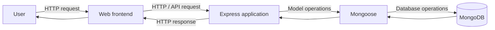

# HiTrack — Architecture Notes

> **Documentation status:** Initial, repository-evidence-based overview. This is not a verified module-level architecture map. The repository's application entry point and route/model source files must be inspected before documenting exact request handlers, collections, or runtime wiring.

## 1. Project overview

HiTrack is a cricket live-score web project. The repository metadata and README identify a JavaScript web frontend/backend with Node.js, Express, MongoDB, and Mongoose.

## 2. High-level system view

The following is a **conceptual system boundary**, not a claim about exact source-file structure:

## 3. Dependencies visible in package metadata

| Dependency | Intended responsibility | Verification status |
| --- | --- | --- |
| Express 5 | HTTP application and routing | Declared in `package.json`; runtime wiring not yet verified |
| Mongoose 9 | MongoDB object modelling | Declared; schemas and model usage not yet verified |
| dotenv | Environment-variable loading | Declared; actual variable names not yet verified |
| cors | Cross-origin request handling | Declared; configuration not yet verified |
| body-parser | Request-body parsing | Declared; middleware wiring not yet verified |
| express-session | Session support | Declared; session store and cookie settings not yet verified |
| bcrypt | Password hashing | Declared; authentication flow not yet verified |

## 4. Data layer and schema inventory

MongoDB and Mongoose are declared dependencies, but the model source files were not available for inspection during this documentation pass. Therefore, this document intentionally does **not** invent collection names, field definitions, references, indexes, validation rules, or relationships.

Before publishing a schema diagram, inspect each Mongoose model and record:

- Collection/model name and purpose
- Fields, BSON/Mongoose types, defaults, and required constraints
- References and relationship cardinality
- Unique and compound indexes
- Validation and lifecycle hooks
- Sensitive fields and access-control expectations

## 5. API documentation status

No endpoint catalogue is published here yet. An accurate API reference must be generated from the actual Express route and controller source, not inferred from the product description.

For each verified endpoint, document:

- HTTP method and route
- Authentication and authorization requirements
- Path/query/body parameters and validation
- Success response and status code
- Error responses
- Example request and response
- Relevant automated test

## 6. Configuration and security

- Keep secrets outside source control and load them through environment configuration.
- Provide an `.env.example` only after confirming the real variable names; include placeholders, never credentials.
- Verify session secret, cookie flags, session-store behavior, CORS origins, and proxy settings before deployment.
- Hash passwords with a suitable password-hashing configuration; never store plaintext passwords.
- Validate request input and enforce authorization at the server boundary.

These are engineering requirements to verify, not claims that each control is currently implemented.

## 7. Verification gaps and next steps

1. Make the real application entry point discoverable and confirm the startup command.
2. Inspect route, controller, middleware, and model files.
3. Produce an endpoint reference from verified routes.
4. Produce an ER-style data model from actual Mongoose schemas.
5. Add tests around existing application behavior.
6. Add CI only after install, test, and any lint/build commands are reliable.

## 8. Current repository-level observations

- The package manifest declares a placeholder `test` script that exits with an error.
- No `start` or `dev` script is declared in the inspected package manifest.
- A `package-lock.json` is present.
- The package manifest declares `index.js` as its main entry, but that file could not be retrieved during this review.

Do not treat a successful dependency installation as proof that the application starts or that its business logic works.
